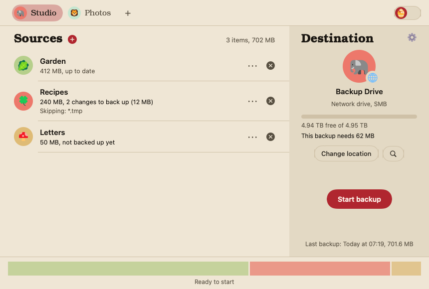

# Overview

Archivist copies any drive, or any folders, to any other drive. It is a free, open-source Mac app from House of Helios.

## What it does

- **Any source, any destination.** Folders, a whole drive, or your home folder, copied to an external disk, another Mac's shared folder, or any folder you choose.
- **Only what changed.** A second backup copies the files that are new or different and leaves the rest alone. A backup where nothing changed takes well under a second.
- **Each drive copied the way it moves best.** An SSD takes many files at once. A spinning disk takes one stream, with small files read in the order they sit on the platter. A shared folder over the network keeps many files in flight to hide the round trips.
- **Every file arrives whole.** A file is written under a temporary name and renamed into place only when it is complete. A power cut or a stop mid-copy never leaves a half file where a good one was.
- **Nothing is lost.** A file you changed or deleted is moved into a dated `_📚archive` folder beside the backup, never deleted. See [Earlier versions](05-earlier-versions.md).
- **Every Mac detail kept.** Tags, custom icons, permissions, dates, resource forks, symbolic links, hard links.
- **Schedules.** Once an hour, once a day, once a week, or whenever the backup drive is plugged in. See [Settings](04-settings.md).
- **Updates itself** from GitHub, each release signed. See [Updates](07-updates.md).

## What it is not

Archivist is not a bootable clone maker, not a cloud service, and does not encrypt or deduplicate. It keeps a plain copy of your files that you can open in the Finder on any Mac, with no Archivist needed to read it back.

## Requirements

macOS 14 Sonoma or later. Runs on Apple silicon and Intel Macs. The app is 1.2 MB.

Next: [Install](02-install.md).
