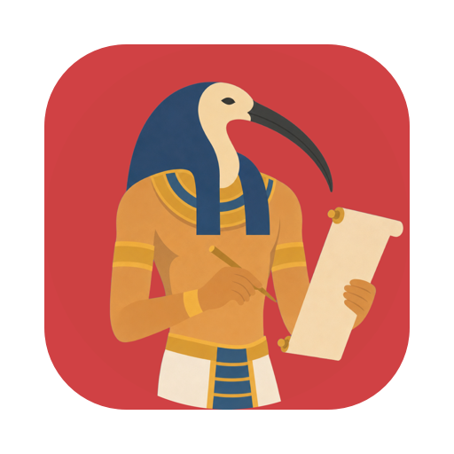

# Install



## 1. Download

Get **Archivist.dmg** from the releases page: https://github.com/House-of-Helios/archivist/releases/latest

The green "Code" button on the repository page gives you the source code, not the app. The app is under Releases.

## 2. Drag to Applications

Open the DMG. Drag **Archivist** onto the **Applications** shortcut beside it. Then eject the DMG.

## 3. First open: "Archivist can't be opened"

House of Helios does not pay Apple for a developer account, so macOS does not know the maker and refuses the first open. This happens once.

1. Open Archivist from Applications. macOS says it can't check the app. Click **Done**.
2. Open **System Settings → Privacy & Security** and scroll down to the Security section.
3. Next to "Archivist was blocked", click **Open Anyway**.
4. Confirm with **Open**, and enter your password if asked.

If Archivist only bounces in the Dock and never opens, it is waiting on these steps: right-click it, choose **Force Quit**, then do step 2. Downloading it again does not help, because every download from a browser asks once.

From then on Archivist opens like any other app. Updates installed through the app do not ask again, because every release carries the same signature.

## Checking the download (optional)

Every release carries a signed `appcast.json` with the SHA-256 of the zip, and the app checks that signature before it installs an update. For the DMG you can compare its checksum with the one shown on the release page:

```
shasum -a 256 ~/Downloads/Archivist.dmg
```

Next: [Your first backup](03-first-backup.md).
