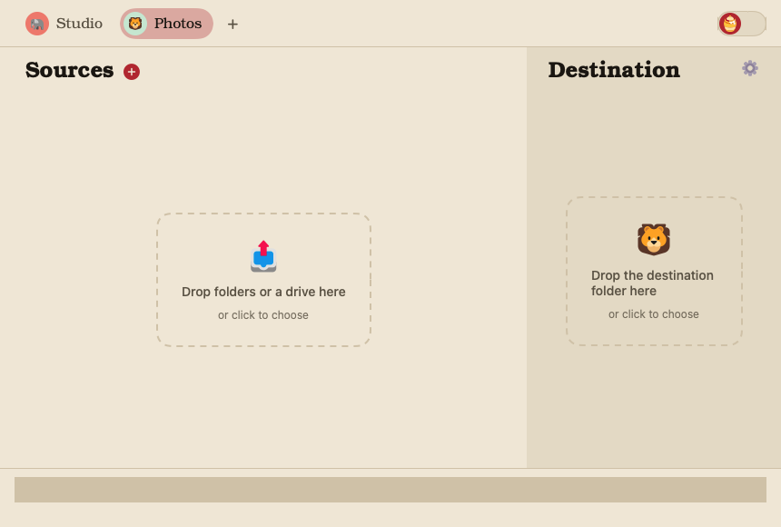
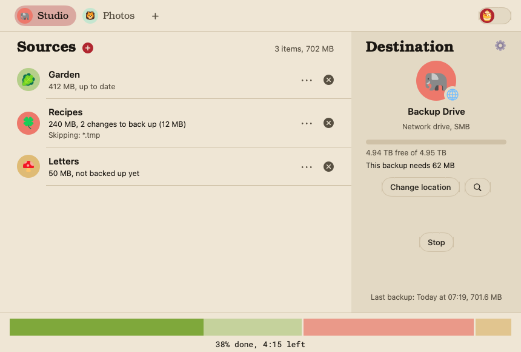
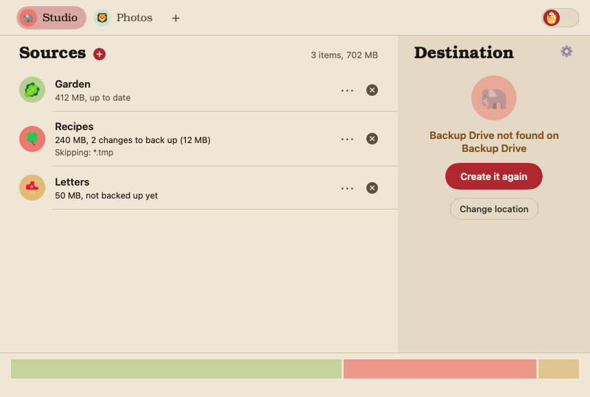

# Your first backup

A backup has sources (what to copy), a destination (where it goes), and one button.

## 1. Sources

Drop folders, or a whole drive, on the left side, or click the dashed box and choose. Each source gets its own picture and colour, a size, and a line saying where it stands: "not backed up yet", "2 changes to back up (12 MB)", "up to date".

The **⋯** menu on a source row:

- **Pause**: keep the source in the list but don't copy it until you choose Resume.
- **Skip a folder inside…**: choose folders inside this source to leave out.
- **Skip junk files**: leave out caches, temp files and `node_modules`.
- **Copy everything again**: ignore what is already there and copy the whole source afresh.
- **Show in Finder**.

The **ⓧ** removes the source from the backup. Nothing at the destination is touched by that.

## 2. Destination

Drop the folder where the backup should live on the right side, or click to choose. Archivist shows the drive it is on, its kind (SSD, spinning disk, network), how much space is free, and how much this backup needs.

The backup lands in a folder named after the backup inside the folder you chose, with one folder per source inside that.

## 3. Start backup

Press **Start backup**. The bar along the bottom shows one chunk per source in its colour, and the time left below it. **Stop** finishes the files in flight and stops; nothing half-copied is kept.

When it is done, the destination panel shows "Last backup: today at 09:42, 701 MB".

## Whole drives and the home folder

To back up a whole drive, drop the drive itself. To back up everything in your home folder, drop your home folder. Both need Full Disk Access: see [Full Disk Access](06-full-disk-access.md).

## When the drive is not there

If the backup drive is unplugged, Archivist says so and waits. Nothing happens to the backup until the drive is back.

Next: [Settings](04-settings.md).
