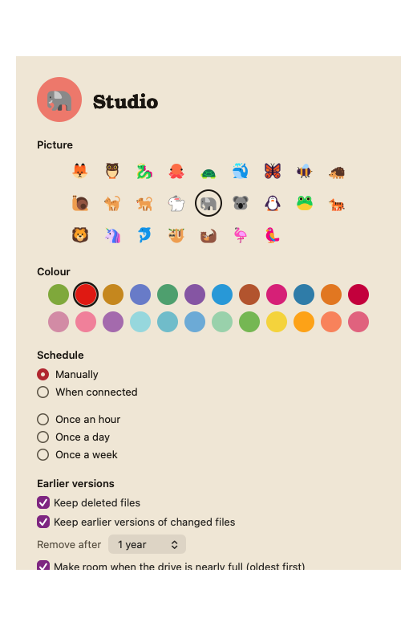

# Settings

The ⚙️ at the top right of the Destination panel opens the settings of the selected backup.

## Name, picture, colour

The name is the backup's title in the tabs along the top. The picture and colour mark it everywhere: on its tab, on the destination, on the folder it writes. Pick any of the animals and any of the colours.

## Schedule

- **Manually**: only when you press Start backup.
- **When connected**: each time the backup drive is plugged in or the shared folder comes back.
- **Once an hour**, at the minute you choose.
- **Once a day**, at the time you choose.
- **Once a week**, on the day and at the time you choose.

Scheduled backups run in the background without a window, through a small helper that macOS starts for you. The first time you choose a schedule, macOS asks you to allow Archivist in **System Settings → General → Login Items & Extensions**. If a scheduled backup skips files, you get a notification.

A scheduled backup that finds the drive unplugged does nothing and tries again at the next slot. A Mac that was asleep at the scheduled time runs the backup when it wakes.

## Earlier versions

- **Keep deleted files**: a file that disappears from the source is moved into the archive, not removed from the backup.
- **Keep earlier versions of changed files**: before a changed file is replaced, the old copy is moved into the archive.
- **Remove after**: how long archived versions stay (30 days, 90 days, 1 year, or never).
- **Make room when the drive is nearly full**: when the backup drive runs short, the oldest archived days are removed first. The newest day is never removed.

See [Earlier versions](05-earlier-versions.md) for what the archive looks like on disk.

## Destination drive type

Archivist reads the kind of drive from the system. A USB enclosure can hide what is inside it; if the kind shown is wrong, set it here. It only changes how fast Archivist tries to copy, never what it copies.

## Appearance

Light, dark, or follow the Mac. The switch at the top right of the window does the same.

## Delete this backup

Removes the backup from Archivist. The files at the destination stay exactly where they are.

Next: [Earlier versions](05-earlier-versions.md).
