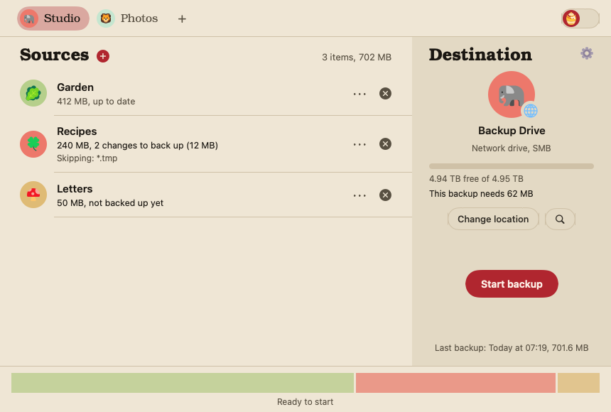

# Earlier versions

Archivist never deletes a file at the destination. Whatever is replaced or gone from the source is moved into a dated folder, and you can open it in the Finder like any other folder.



## Where they are

At the top of the backup folder there is a folder named `_📚archive`. Inside it, one folder per backup run that moved something, named by date and time, and inside that the files at the same paths they had in the backup:

```
Backup Drive
└── Studio
    ├── Garden
    ├── Recipes
    ├── Letters
    └── _📚archive
        ├── 2026-11-20 091500
        │   └── Recipes
        │       └── bread.md        ← the version replaced on 20 November
        └── 2026-11-24 183000
            └── Letters
                └── to-maria.txt    ← deleted from the source on 24 November
```

The leading underscore keeps the folder at the top of the list in the Finder.

## Getting a file back

Open the archive folder in the Finder, find the date, and copy the file back where you want it. There is nothing to restore through the app: the backup and its archive are plain folders.

## How long they stay

The **Remove after** setting (see [Settings](04-settings.md)) removes whole dated folders once they are older than the time you chose. With **Make room when the drive is nearly full** on, the oldest dated folders are removed first when the drive runs short of space. The newest dated folder is never removed, whatever the settings.

## Backing up a backup

A backup folder can itself be a source. Its `_📚archive` folder belongs to that backup and is left out of the copy.

Next: [Full Disk Access](06-full-disk-access.md).
