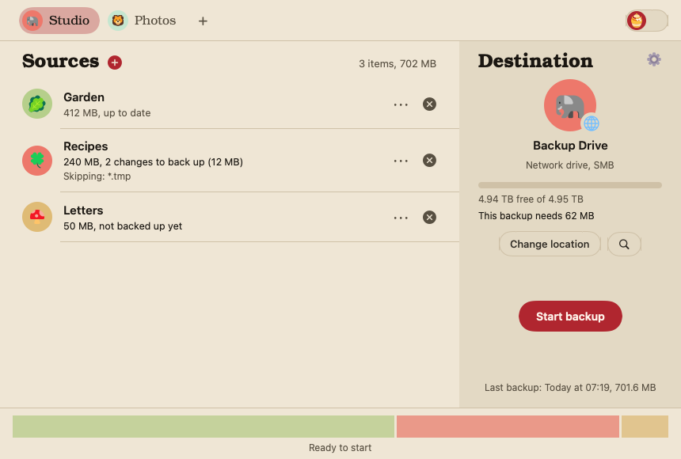

# Full Disk Access

macOS lets an app read your Desktop, Documents and Downloads only after you say so, and it keeps some folders (Mail, Messages, Safari, Photos libraries) behind a further gate called Full Disk Access. To back up a whole drive or your home folder, Archivist needs that gate open.

## Turn it on

1. Open **System Settings → Privacy & Security → Full Disk Access**.
2. Click **+**, choose **Archivist** in Applications, and turn its switch on.
3. Quit and reopen Archivist.

## Without it

Archivist still copies everything it can reach. Any file it was not allowed to read is listed by name under the progress bar when the backup finishes, with "Permission denied". Nothing is silently skipped.

## Removable and network drives

The first time Archivist writes to an external drive or a shared folder, macOS asks whether to allow it. Say yes once; because every release of Archivist carries the same signature, macOS remembers the answer across updates.

Next: [Updates](07-updates.md).
