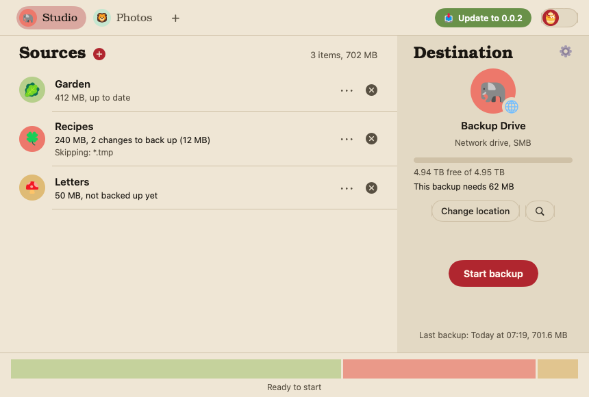
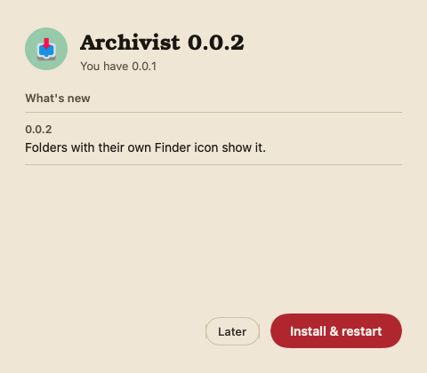

# Updates

Archivist checks its GitHub releases when it opens and once an hour after that. When a newer version is out, a green button appears at the top of the window.

## Installing one

Click the button. A sheet lists every version newer than yours and what changed in each.

- **Later** closes the sheet; the button stays until you install.
- **Install & restart** swaps the new version in and reopens Archivist. It takes a few seconds. If a backup is running, the update waits until it is done.

The download happens in the background as soon as the new version is seen, so installing is quick.

## What is checked

An update is installed only when all of these hold:

1. The release's note is signed by the Archivist release key, over the version number and the fingerprint (SHA-256) of the download. The signature is checked before a single byte is downloaded.
2. The downloaded file has exactly that fingerprint.
3. The unpacked app carries the same code signature as the one you are running, and a newer version number.

If any check fails, nothing is installed and the running app is left as it is. Archivist talks to nothing on the internet except that one GitHub page.

## By hand

You can always download the latest DMG from the releases page and drag it over the old copy in Applications. Your backups and settings stay; they live outside the app.
